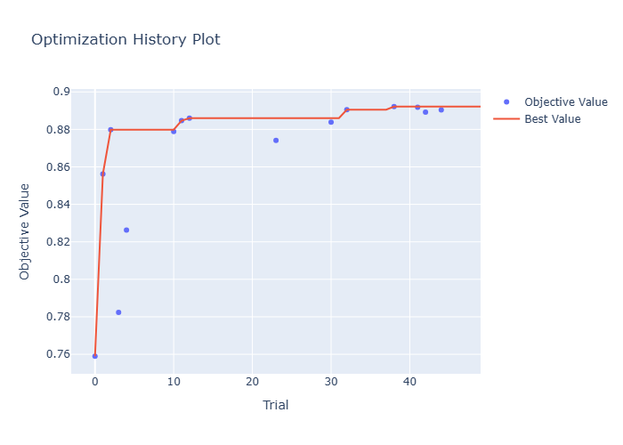
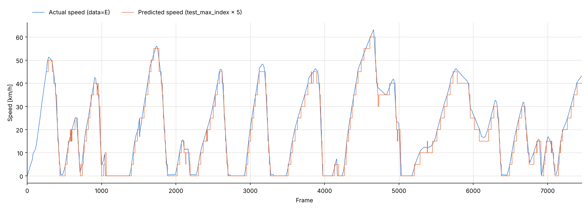
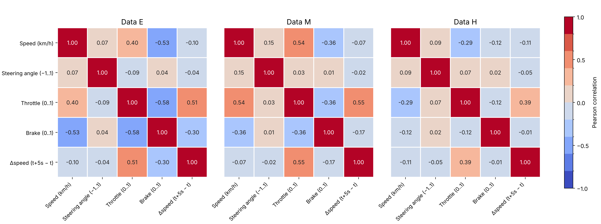

# Vehicle Speed Prediction with LSTM

Short-term (5 s) vehicle speed forecasting from driving simulator data, built as the
input signal for a model predictive controller in a hybrid powertrain.

**Achieves ≈ 3 km/h RMSE on held-out test sessions, against an ≈ 8 km/h persistence baseline (≈ 62% reduction).**

Undergraduate thesis, Dept. of Electrical and Electronic Engineering, Tokyo Denki
University (Mar 2025 – Mar 2026).

---

## 1. Motivation

A hybrid vehicle switches between its engine and its electric motor. Choosing *when* to
switch determines fuel efficiency, and the decision is made by a model predictive
controller (MPC).

An MPC optimizes over a finite horizon, which means it needs to know what the vehicle
will be doing over that horizon. The prediction horizon here is 5 seconds — so the
controller requires a 5-second-ahead forecast of vehicle speed as an input signal.

**The 5-second horizon is not an arbitrary modeling choice. It is a requirement imposed
by the downstream control task.**

This repository contains the prediction model, its evaluation, and the data quality
analysis behind it.

---

## 2. Problem setup

| | |
|---|---|
| **Task** | Predict vehicle speed at *t* + 5 s from history up to *t* |
| **Inputs** | Vehicle speed, throttle position, steering angle, brake |
| **Data** | Urban driving in Kyoto city on a driving simulator, collected by the author |
| **Drivers** | 6 in total. Training uses 4 drivers; the test sessions come from 3 drivers, 2 of whom never appear in training (1 driver appears in both) |
| **Input window** | 60 time steps |
| **Model** | LSTM classifier over 5 km/h speed classes |
| **Output** | Predicted class index × 5 km/h |

Throttle and brake at time *t* are causally upstream of speed at *t* + 5 s, so using
them as inputs is legitimate. **No control inputs from after time *t* enter the input
window** — including them would make the task trivial and the result meaningless.

---

## 3. Method

The task is framed as **classification**. The speed at *t* + 5 s is discretized into
5 km/h classes, the LSTM predicts the most likely class, and the prediction is the
class index × 5 km/h. Training and model selection use classification accuracy (the
share of samples assigned to the correct class); RMSE in km/h is reported on top of
that for interpretability.

Hyperparameters (layer count, hidden units, learning rate, dropout rates, weight decay,
batch size and input window length) were tuned by Bayesian optimization with Optuna (TPE)
over 50 trials. The search objective was computed on validation data only; the test
sessions were never used during tuning.

The input window was searched over {15, 30, 60, 120, 240} steps. On the main dataset the
best trials used **60 steps**. (The 240-step window was sampled only once in this search.)

**The best window depends on how the driver decelerates.** In a separate experiment on
data dominated by engine braking, a **240-step window performed best**. Engine braking
slows the vehicle more gradually than the brake pedal, so a slowdown builds up over a
longer stretch of history, and a longer window captures more of it. This fits the
data-quality analysis in Section 5: in engine-braking-heavy sessions, the brake pedal
carries little information about the coming deceleration.

The final model uses 60 steps: it was best on the main dataset, and training at 240 steps
was much slower on the available GPU.



*Figure 1. Optuna optimization history over 50 trials (objective: classification
accuracy on validation data, higher is better; only completed trials are plotted). Most of the gain came
within the first few trials; later trials improved the best value only marginally
(≈ 0.88 → 0.89).*

---

## 4. Evaluation

### Baseline

The natural baseline for a 5-second horizon is **persistence**: assume the vehicle will be
travelling at the same speed 5 seconds from now.

Taking the RMS of the difference between speed at *t* and speed at *t* + 5 s across the
dataset gives **≈ 8 km/h** — by definition, the persistence baseline's error.

| Model | RMSE |
|---|---|
| Persistence baseline | ≈ 8 km/h |
| LSTM (held-out test sessions) | ≈ 3 km/h |

Reporting model error without this comparison would be meaningless: if speed barely
changed over 5 seconds, a low RMSE would be trivial to achieve.

### Generalization across drivers

The model is trained on human driving, so the thing being predicted is partly the
driver's own habits. Evaluation was therefore done on **separate sessions, mostly from
drivers who do not appear in training**, rather than on held-out windows from the same
sessions — random windowing would place near-identical samples in both training and test.



*Figure 2. Actual speed and LSTM prediction on an urban test session (driver E). The
staircase shape comes from the 5 km/h classes.*

### Out-of-distribution robustness

The training distribution is urban driving, dominated by acceleration and stopping at
traffic lights. Five held-out sessions were used for final evaluation:

- **3 × urban driving** — in-distribution
- **1 × constant 60 km/h cruising** — a regime absent from training
- **1 × hard acceleration and braking** — the tail of the training distribution

---

## 5. Training data quality analysis

Performance on held-out data varied substantially depending on which training sessions
were included. Splitting the training set and measuring each subset's contribution
identified **four sessions that consistently degraded performance**.

Hypothesis: sessions where vehicle speed responds weakly to the control inputs are
harmful, because the model cannot learn the brake→deceleration relationship from them.

Testing this with a correlation matrix over the four input channels confirmed it: in the
harmful sessions, the correlation between brake and speed was markedly lower. Those
drivers decelerated mainly with engine braking rather than the brake pedal.



*Figure 3. Correlation between the inputs, speed and the 5-second speed change
Δspeed (t+5s − t) in three datasets. In dataset H, the brake signal is almost
uncorrelated with the coming speed change (−0.01, versus −0.30 and −0.17 in E and M),
while throttle remains informative in all three.*

### Label noise during constant-speed cruising

An early model produced oscillating predictions during constant-speed cruising. Analysis
of the constant-speed recordings showed the cause was not the model: drivers asked to
hold 60 km/h were actually varying between roughly 58 and 64 km/h. The oscillation was
**noise in the target signal being learned as if it were signal**.

Applying a moving average to the target reduced the oscillation.

This is a trade-off, not a free improvement: smoothing suppresses oscillation but also
slows the response to genuine rapid changes, which is exactly what the hard
acceleration/braking test probes.

---

## 6. Limitations

- **No comparison against simpler models.** A linear model with lagged features may well
  recover most of the LSTM's performance. This was not tested, so the necessity of an
  LSTM here is unverified.
- **Quantization error is built into the output.** Predictions are the lower edge of the
  predicted 5 km/h class, so they are biased low, and quantization alone accounts for a
  large part of the ≈ 3 km/h RMSE (≈ 2.9 km/h for a perfect classifier if errors within a
  class are uniform). Using class centers or the probability-weighted mean of the classes
  would remove this bias at no cost.
- **Session exclusion was judged on held-out performance.** The four harmful training
  sessions were identified by how removing them changed held-out performance. If those
  held-out sessions overlap with the final test sessions, the reported RMSE may be slightly
  optimistic.
- **Not a strictly unseen-driver test.** One of the three test drivers also appears in
  training. Reporting RMSE separately for the two fully unseen drivers would give a
  cleaner estimate of cross-driver generalization.
- **Baseline computed on a different set of samples.** The persistence figure was computed
  across the whole dataset rather than only on the test sessions. Recomputing it on exactly
  the same sessions would make the comparison strictly like-for-like.
- **No coupled evaluation with the MPC.** The real objective is fuel efficiency; RMSE is a
  proxy for it. Prediction errors during acceleration and during steady cruising
  contribute equally to RMSE but affect the switching decision very differently. The two
  metrics were never checked against each other.
- **Correlation analysis is linear and uses a single lag.** Inputs at *t* are compared with
  the 5-second speed change, but how quickly the brake acts on speed was not examined; a
  lagged cross-correlation over several horizons would characterize responsiveness more
  precisely.
- **Simulator data, not real vehicles.** The data-generating process is human driving in a
  simulator, which is smoother and more regular than real traffic.

---

## 7. Repository structure

```
src/          model definition, training, evaluation
notebooks/    analysis
data/sample/  representative sessions (full dataset available on request)
figures/      figures used in this README
```

### Reproducing

```bash
pip install -r requirements.txt
python src/train.py
```

Trained weights and the full dataset are not included in the repository. The full dataset
is available on request.

---

## Notes

Thesis title: *Performance Evaluation of an LSTM-Based Short-Term Motion Prediction Model*
